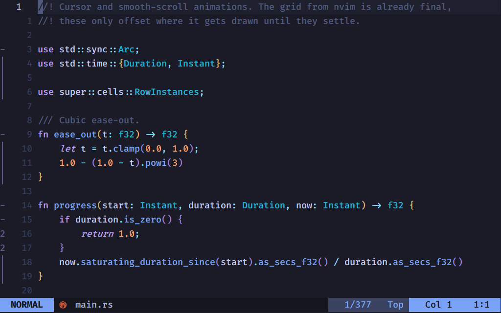
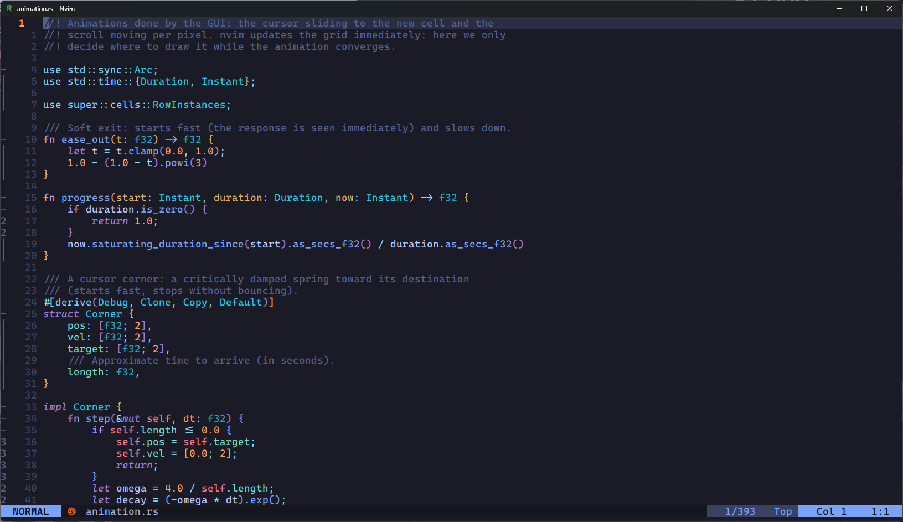

<p align="center"></p>

<h1 align="center">nvright</h1>

A Neovim GUI for Windows, for people who run Neovim inside WSL. I wanted two
things from it: low input latency and text as sharp as in Zed.

It's a native Windows app in Rust (winit, wgpu on DX12, DirectWrite for the
text) that starts `nvim --embed` in your WSL distro, with your usual config and
plugins.





## Why

I run Neovim in WSL, and on Windows the obvious GUI for that is Neovide. But
typing never felt quite as immediate as I wanted, and after Zed I missed its
text: real ClearType, rasterized by
DirectWrite with the system gamma and contrast, not an approximation.

So I started this to see how far I could get caring mostly about those two
things. It does less than Neovide and only targets one setup, Windows with
Neovim in WSL.

On my machine, with a full config (treesitter, LSP, completion), key press to
presented frame is about **3 ms median, 5 ms p90**, and nearly all of that is
Neovim itself. Use `--latency` to measure it on yours.

## Features

- Text: DirectWrite + ClearType subpixel AA, gamma/contrast correction in
  the shader via dual-source blending. Ligatures are shaped per segment but
  stay anchored to the grid. Font weight and size come from `guifont` (Neovide
  syntax). Color emoji.
- Redraws only on Neovim `flush`, or during animations, paced to
  the monitor refresh with `DwmFlush`. Mailbox presentation, per-row instance
  caching, nothing done on idle frames.
- Animations, all optional: Neovide-style cursor trail, smooth scrolling
  per window, fade-in of typed characters, and the text right of the cursor
  sliding over when you type mid-line.
- **Markdown preview** in a panel next to Neovim, drawn by the GUI
  (`Ctrl+Shift+M` or `:NvrightPreview`). Proportional text, headings in
  the colorscheme's colors, lists, task lists, quotes, GitHub alerts,
  footnotes, tables, code blocks highlighted with Neovim's treesitter parsers,
  the HTML you find in READMEs (centered logos, `<kbd>`, ...), and local or
  remote images in PNG/JPEG/GIF/WebP/SVG, badges side by side. It updates as
  you type and scrolls with the Neovim window. Clicking a link opens it (web,
  `#heading`, or another file in Neovim); clicking anywhere else moves the
  cursor to that line. Parsing and layout run on a separate thread and don't
  affect typing latency.
- ext_multigrid, one grid per Neovim window. Floating windows get soft
  shadows, `winblend`/`pumblend` transparency and a dimmed backdrop when
  focused.
- On the Windows side: native title bar and icon, Start menu shortcut, remembered
  window geometry (maximized too), no white flash on startup, full mouse
  support, AltGr and IME-composed text, Ctrl +/-/0 zoom, Alt+Enter to
  maximize. Optional translucent background with acrylic blur.
- Starts `nvim` through `wsl.exe` in the distro and folder taken from
  the current directory, and kills it when the window goes away. `:restart`
  works too: the window stays open and reattaches to the new server through a
  small bridge run by `nvim -l` in WSL.

## Requirements

- Windows 10/11 with a DX12-capable GPU (Vulkan is used as a fallback).
- WSL with Neovim 0.12.5 or newer installed in the distro (tested with 0.12.6).
- A Nerd Font if your config uses icons.

## Building

nvright is developed in WSL and cross-compiled for Windows with
[cargo-xwin](https://github.com/rust-cross/cargo-xwin).

One-time toolchain setup (in WSL):

```sh
curl --proto '=https' --tlsv1.2 -sSf https://sh.rustup.rs | sh -s -- -y --component llvm-tools,clippy,rustfmt
rustup target add x86_64-pc-windows-msvc
cargo install cargo-xwin --locked
```

The first build downloads the MSVC CRT and SDK into `~/.cache/cargo-xwin`; the
linker is `rust-lld`.

```sh
scripts/build-win.sh --release   # build, install and create the Start menu shortcut
scripts/run-win.sh --release     # same, then launch it with logs in the terminal
scripts/build-win.sh             # debug build with a console window
cargo check && cargo test && cargo clippy --all-targets   # quick checks on Linux
```

The release build is installed to `%LOCALAPPDATA%\nvright\bin\`, plus a
`nvright` entry in the Start menu that starts Neovim in your WSL home.
Launch that copy. An `.exe` run from the WSL filesystem is sometimes a stale
cached version. Installing fails while an instance is running, since Windows
locks the file.

## Usage

```
nvright [options] [file...] [-- arguments for nvim]
```

Started from a WSL terminal, Neovim opens in the current folder of that distro.

### Options

| Option | Default | |
|---|---|---|
| `--font <family>` | from `guifont`, then Cascadia Mono | font family |
| `--font-size <pt>` | from `guifont`, then 12 | font size |
| `--font-weight <100-900>` | from `guifont` (`:w500`), then 400 | text weight |
| `--antialias <subpixel\|grayscale>` | subpixel if ClearType is on | text antialiasing |
| `--hinting <none\|full>` | none | glyph hinting |
| `--cursor-animation <ms>` | 60 | cursor animation, 0 = off |
| `--cursor-trail <0-1>` | 0.4 | how far the leading corners run ahead |
| `--scroll-animation <ms>` | 120 | smooth scrolling, 0 = off |
| `--text-fade <ms>` | 70 | fade-in of typed characters, 0 = off |
| `--text-slide <ms>` | 0 | slide of the text after the cursor when typing mid-line |
| `--backdrop <0-1>` | 0.3 | dimming behind a focused floating window |
| `--opacity <0.1-1>` | 1 | opacity of the default background, text stays opaque |
| `--blur` | | acrylic blur behind a translucent window (Windows 11) |
| `--preview-width <0.2-0.8>` | 0.45 | share of the window taken by the markdown preview |
| `--preview-font <family>` | Segoe UI | font of the markdown preview |
| `--preview-font-size <pt>` | the editor font size | text size of the markdown preview |
| `--no-floating-shadow` | | no shadows under floating windows |
| `--no-multigrid` | | single grid, Neovim composes the windows |
| `--present-mode <mode>` | mailbox, else fifo | `fifo`, `fifo-relaxed`, `mailbox`, `immediate` |
| `--bg <#rrggbb>` | | background color before Neovim sends its own |
| `--latency` | | log the latency of every input |
| `--log <filter>` | `warn,nvright=info` | `env_logger` filter |
| `--distro <name>`, `--cwd <path>` | from the current directory | where to start Neovim |
| `--nvim <path>`, `--wsl <path>` | `nvim`, `wsl.exe` | executables |
| `--shell <path>` | | start Neovim through a login shell (for its `PATH`) |
| `--no-wsl` | | run `nvim` directly, without WSL |
| `--config <path>` | see below | configuration file |

### Configuration file

Every option can also go in `%APPDATA%\nvright\config.toml`
(`~/.config/nvright/config.toml` on Linux), with the same name and no
`--`. The command line wins over the file.

```toml
font = "FiraCode Nerd Font"
font-size = 13.5
font-weight = 500
text-fade = 120
text-slide = 120
# args = ["-u", "~/.config/nvim/minimal.lua"]
```

The window position, size and maximized state are saved in `window.toml` in the
same folder.

### Neovim side

`g:nvright = 1` is set before your config loads, for GUI-only settings:

```lua
if vim.g.nvright then
  vim.o.guifont = 'CaskaydiaCove\\ Nerd\\ Font:h13.5:w500'
end
```

It's worth turning off plugins that animate inside the grid (`snacks.scroll`,
`smear-cursor`, ...) when `vim.g.nvright` is set. nvright animates the
cursor and scrolling itself, without holding back the real update.

### Shortcuts

These are handled by the GUI and never reach Neovim:

- `Ctrl` + `+` / `-` / `0`, `Ctrl` + mouse wheel: zoom;
- `Alt` + `Enter`: maximize / restore;
- `Ctrl` + `Shift` + `V`: paste the Windows clipboard in any mode. In a
  `:terminal` it is a bracketed paste, so multi-line commands are not run;
- `Ctrl` + `Shift` + `M`: show / hide the markdown preview (same as
  `:NvrightPreview`, `:NvrightPreview!` hides it). It follows the
  current markdown buffer and keeps the last one while you edit other files.
  The mouse wheel over the panel scrolls it on its own until Neovim scrolls.
  A click on a link follows it, anywhere else it moves the cursor to that line.

## Measuring latency

With `--latency` every input logs its timeline: `nvim` (round trip to WSL plus
Neovim's work up to `flush`), `queue`, `wait`, `vsync` and `render`. A
p50/p90/p99 summary is printed every 20 samples and on exit. Run it from a WSL
terminal to see the log:

```sh
scripts/run-win.sh --release -- --latency some_file.ts
```

## How it works

- `src/nvim/`: launches `nvim --embed` via `wsl.exe` (inside a Job object, so it
  dies with the window) and parses the `ext_linegrid` redraw events.
- `src/editor/`: grid state with stable row ids, highlights, multigrid layout,
  and the change log that drives the animations.
- `src/renderer/`: one instanced pipeline for backgrounds, glyphs and
  decorations, a glyph atlas, per-row instance caching, DirectWrite (Windows)
  or swash (elsewhere) rasterization, and the cursor/scroll/text animations.
- `src/preview/`: the markdown preview. A small Lua module installed at attach
  time sends the buffer text (debounced), the treesitter highlights of its code
  blocks (cached per block), the visible lines and the theme colors;
  `pulldown-cmark` parses it and `cosmic-text` lays it out into glyphs,
  rectangles and images on a background thread, drawn by the same pipeline as
  the grid (plus a textured quad per image). Images are decoded with `image`
  and `resvg` (SVG); remote ones are downloaded with the system `curl`.
- `src/app.rs`: the winit event loop, input translation and window management.

To regenerate the icon after editing `assets/icon.svg`:

```sh
cargo run --release --manifest-path tools/icon/Cargo.toml
```

## Roadmap

Next: a prebuilt release you can install with Scoop, a scrollbar with search
and diagnostic marks, animated floats and a taskbar jump list. More in
[ROADMAP.md](ROADMAP.md). If something breaks on your setup, open an issue.

## License

MIT, see [LICENSE](LICENSE).
